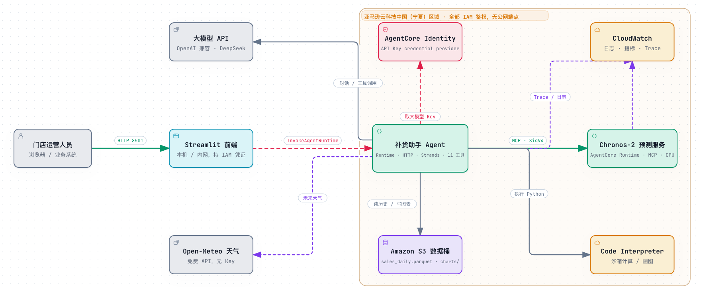

# AI 销量预测方案（AgentCore 版）：中国区部署方案说明

> 基于 Amazon Chronos-2 时序预测模型 + Amazon Bedrock AgentCore，实现自然语言驱动的销量预测与补货建议。
> 本方案已于 2026 年 10 月在 AWS 中国（宁夏）区域完成实际部署验证，全部测试使用贵司真实门店销售数据。
> 相比 2026 年 8 月交付的 SageMaker GPU 版本，本版本去掉了常驻 GPU 端点和公开接口，按使用量计费并默认鉴权。

---

## 一、方案概述

业务人员用自然语言提问（如"5 号店 12080084 下周卖多少，库存 120 件一箱 12 件要订几箱"），云上的补货助手 Agent 自动取历史销量、查天气、调用预测模型、精确计算补货量，秒级返回结果。数据分析师也可以用 Claude、Kiro 等 AI 助手直接连接预测服务。

```
方式 A：数据分析师直连预测服务
  AI 助手（Claude Code / Kiro / Cursor）
    → mcp-proxy-for-aws（本机签名）
    → AgentCore Runtime ②：Chronos-2 预测服务（MCP 协议，CPU 推理）

方式 B：业务人员通过云上 Agent
  业务系统（企业微信 / 钉钉机器人 / 内部 Web）
    → AgentCore Runtime ①：补货助手 Agent
         ├─ 大模型（DeepSeek 等国产模型 API，Key 托管在 AgentCore Identity）
         ├─ Runtime ②：Chronos-2 预测
         ├─ 天气服务（Open-Meteo，提供未来天气作为预测输入）
         ├─ Code Interpreter：精确计算补货量、生成趋势图
         └─ 销售历史数据（Amazon S3，后续可换为贵司数据库）
```

**核心组件说明：**

| 组件 | 说明 |
|------|------|
| Chronos-2 模型 | Amazon 开源的时序预测基础模型（Apache 2.0，商用无限制），零样本预测，支持天气、促销等业务因素作为输入。本版本用 CPU 推理，结果与 GPU 完全一致 |
| AgentCore Runtime | 托管预测服务和 Agent 的无服务器运行环境。每个会话独立隔离，按实际使用的 CPU 和内存按秒计费，无会话时不收费，默认 IAM 鉴权 |
| AgentCore Identity | 托管大模型 API Key，Agent 运行时按需获取，Key 不出现在代码、镜像或配置中 |
| AgentCore Code Interpreter | 隔离的 Python 沙箱，让 Agent 做精确计算（补货量扣减库存、按箱规取整）和画图，避免大模型"心算"出错 |
| AgentCore Observability | 每次对话的完整调用链：大模型耗时、每个工具耗时、token 用量，用于排障和成本分析 |
| 天气服务 | 内置 Open-Meteo（免费、无需 Key）天气接口，取门店所在城市的未来天气作为预测协变量 |



**Agent 提供的能力（面向门店运营人员，用业务语言回答：预计销量 / 最多备货量）：**

1. **单品预测**：未来 N 天逐日预计销量与最多备货量（统计上的 P50 / P90），结论先行
2. **带业务因素的预测**：节假日（内置中国法定节假日日历）、促销计划（提问时说明促销日期即可）、价格、天气（Open-Meteo）、星期一起作为预测输入，并与不带因素的基线对比
3. **批量预测**：各门店热销 Top-N 商品一次预测，生成 Excel 报表（60 个商品约 3 秒）；也可用命令行脚本定时跑批
4. **补货计算（考虑保质期）**：读取商品主数据（保质期、到货周期、箱规、起订量）和库存快照（现有库存、在途、到期日），短保商品按预计销量、长保按最多备货量，扣减可用库存、按箱规取整，并提示过期风险
5. **准确率回测**：在历史数据上滚动回测，给出基线与带因素模型的准确率（本次数据：64.5% → 76.3%）
6. **库存查询、趋势图**：库存可售天数；历史 + 预测区间图表保存到贵司 S3
7. **多轮对话**：同一会话内记住上下文（"这个商品要补多少货"）

## 二、与 8 月版本的变化

| 维度 | 8 月版本（SageMaker GPU + API Gateway + Lambda） | 本版本（AgentCore） |
|------|------|------|
| 预测算力 | ml.g4dn.xlarge GPU 常驻 | CPU，每会话最多 2 vCPU / 8 GB |
| 月成本（POC 量级） | 约 1,150～3,740 元 | 约 25 元（方式 A）/ 约 195 元（方式 B，含大模型费用） |
| 闲置成本 | 端点开着就按小时计费 | 无会话时为零，仅镜像存储约 1 元/月 |
| 接入鉴权 | 公开无鉴权 | 默认 IAM 鉴权，匿名访问被拒绝 |
| 组件数 | 3 个 | 1 个 Runtime（方式 A）/ 2 个 Runtime（方式 B） |
| 冷启动 | 端点删除后重建约 25 分钟 | 新会话 3～5 秒 |
| 单品预测延迟 | 约 1.2 秒 | 约 0.4～0.5 秒 |
| 批量 1,000 个 SKU | 3.9 秒 | 26 秒（每日全量跑批约 4 分钟，可接受） |
| 业务人员使用 | 需本地配置客户端 | 通过业务系统调用，无需 AWS 账号 |

预测结果数值一致（最大差异 1e-4，为浮点误差），精度与 8 月版本相同。

## 三、中国区适配说明

| 环节 | 方案 |
|------|------|
| AgentCore 可用范围 | 中国区提供 Runtime、Identity、Gateway、Code Interpreter、Browser、Observability；Memory 等不提供，本方案不依赖 |
| 大模型 | 中国区无 Amazon Bedrock 基础模型，使用国产模型 API（已验证 DeepSeek V4 Flash，任何 OpenAI 兼容接口均可切换） |
| 鉴权 | 中国区无 Amazon Cognito，Runtime 入站用 IAM；面向业务人员可接贵司已有的 OIDC 身份系统（见第七节） |
| 模型权重 | ModelScope 魔搭社区 Amazon 官方镜像 `amazon/chronos-2`，打进容器镜像，运行时不依赖外网 |
| 依赖安装 | 镜像构建时走境内 PyPI 镜像源 |
| 链路追踪 | 需在账号内开启 CloudWatch Transaction Search（部署脚本已包含） |
| 数据不出境 | 销售数据、预测全程在宁夏区域；大模型调用会把对话内容（门店代码、商品代码、销量）发送给模型服务商，需贵司确认，如不允许可改为 SageMaker 自托管模型 |

## 四、部署流程（一个 CloudFormation 模板，首次 20～30 分钟）

**前提条件**：中国区 AWS 账号并已开通 Bedrock AgentCore；部署机有 AWS CLI v2（已配置中国区凭证）和 Python 3.10+；一个 OpenAI 兼容的大模型 API Key；门店销售 Excel（格式见 `docs/销售数据格式说明.md`）。**不需要本机 Docker**，镜像由 CodeBuild 在区域内构建。

```bash
# 0. 取代码与依赖
git clone https://github.com/lwjepiphany-maker/chronos2-agentcore-cn.git && cd chronos2-agentcore-cn
pip install -i https://mirrors.aliyun.com/pypi/simple pandas pyarrow openpyxl boto3

# 1. 销售数据 Excel → parquet
python iac/prepare_data.py 门店销售数据.xlsx data/sales_daily.parquet

# 2. 一键部署：建栈（含镜像构建）→ 上传数据 → 打印 Agent ARN、前端命令
LLM_API_KEY='<大模型 API Key>' bash iac/deploy.sh https://github.com/lwjepiphany-maker/chronos2-agentcore-cn.git data/sales_daily.parquet

# 3. 商品主数据与库存（补货功能用）：暂无真实数据时先用模拟数据
python tools/mock_master_data.py --parquet data/sales_daily.parquet --out data/master --upload s3://<数据桶>/master/

# 4. 启动前端
pip install -i https://mirrors.aliyun.com/pypi/simple -r frontend/requirements.txt
streamlit run frontend/app.py -- --agent-arn <Agent ARN> --data-bucket <数据桶> --region cn-northwest-1
```

模板做的事：创建私有数据桶（Block Public Access + 加密 + 版本控制）和两个 ECR 仓库 → CodeBuild 拉取源码、从 ModelScope 下载模型权重、构建并推送两个 arm64 镜像（源码未变的镜像直接复用）→ 把大模型 Key 存入 AgentCore Identity → 开启 CloudWatch Transaction Search → 创建最小权限执行角色和两个 AgentCore Runtime。改 `IMAGE_TAG` 重新执行即滚动升级（约 6 分钟），失败自动回滚；`aws cloudformation delete-stack` 一键删除（数据桶保留）。源码可以从 GitHub 拉取，也可以把交付包 zip 放到贵司 S3 离线部署。

**前端（本机 / 内网）**：聊天式页面，支持多轮、示例问题、图表内嵌、Excel 报表下载、上传销售 Excel 更新数据、处理中停止、撤回修改、名词解释。

**业务系统调用（Python）**：

```python
import boto3, json
rt = boto3.client("bedrock-agentcore", region_name="cn-northwest-1")
r = rt.invoke_agent_runtime(
    agentRuntimeArn="<Agent ARN>", qualifier="DEFAULT",
    runtimeSessionId=session_id,      # 同一会话复用，Agent 记住上下文；至少 33 个字符
    runtimeUserId=user_id,            # 必填
    contentType="application/json", accept="application/json",
    payload=json.dumps({"prompt": "预测5号店商品12070007下周销量"}).encode())
print(json.loads(r["response"].read())["result"])
```

**数据分析师直连预测服务**：栈输出 `McpProxyCommand` 复制到 Claude Code / Kiro 执行即可。

## 五、已完成的验证（2026 年 10 月 · 宁夏区）

| 验证项 | 结果 |
|--------|------|
| 预测服务部署与推理 | 通过（单品 / 带协变量 / 批量 100 和 1,000 条）；与 GPU 端点输出一致 |
| 真实数据回测 | Top 100 门店-商品组合 WAPE 0.29（约 71% 精度），与 8 月版本一致 |
| AI 助手直连（方式 A） | 通过（Claude Code 经 mcp-proxy-for-aws 调用） |
| 云上 Agent 多轮对话（方式 B） | 通过：预测 → 补货箱数计算 → 画图 → 天气影响对比，共 4 类问题，上下文记忆正确 |
| 带天气预测 | 通过：Open-Meteo 取未来 7 天天气，带天气 P50 合计 172.5 vs 基线 182.4 |
| 大模型 Key 托管 | 通过（AgentCore Identity，运行时获取 0.14 秒） |
| 链路追踪 | 通过：一次对话 32 个 span，可看到每次大模型调用和工具耗时 |
| 安全 | 匿名访问预测服务与 Agent 均返回 403；数据桶 Block Public Access |
| VPC 内访问 | 通过（私有子网 + NAT），用于后续直连贵司数据库 |
| 批量预测 | 通过：6 店 × Top10 共 60 个商品一次预测 5 秒，生成 Excel 报表 |
| 带业务因素预测与回测 | 通过：5 号店 Top10 最近 3 周滚动回测，基线准确率 64.5%，加入节假日 / 促销 / 价格 / 天气后 76.3% |
| 保质期补货 | 通过（模拟主数据）：长保商品按最多备货量、短保按预计销量，扣减可用库存、按箱规取整并提示过期风险 |
| 一键部署脚本 | 通过：从 GitHub 源完整部署并多次滚动升级 |

## 六、成本估算（人民币，中国区官网按需价格）

整套方案的全部费用如下（不只是 AgentCore）。AgentCore Runtime / Code Interpreter 按会话实际消耗的 CPU 和内存按秒计费（Runtime：0.867 元/vCPU-小时、0.115 元/GB-小时；Code Interpreter：0.608 元/vCPU-小时、0.064 元/GB-小时）；大模型按 token（DeepSeek V4 Flash：输入 3 元、缓存命中 1 元、输出 9 元 / 百万 token）；AgentCore Identity 经 Runtime 调用免费；Open-Meteo 天气免费。

| 一次 3 轮对话 | 费用 |
|------|------|
| AgentCore Runtime ×2（Agent + 预测服务） | 约 0.05 元 |
| AgentCore Code Interpreter（算补货 / 画图时） | 约 0.02 元 |
| 大模型 | 约 0.10 元 |
| **合计** | **约 0.17 元** |

| 场景（每月 22 个工作日） | 方式 A：直连预测服务 | 方式 B：云上 Agent（含大模型） |
|------|------|------|
| POC：10 人 × 每天 5 次 | **约 25 元 / 月** | **约 195 元 / 月** |
| 试运行：50 人 × 每天 10 次 | 约 240 元 / 月 | 约 1,950 元 / 月 |
| 每日全量跑批（约 9,500 个门店-商品组合，不经大模型） | 约 6 元 / 月 | 约 6 元 / 月 |
| 固定费用（镜像存储、Key 托管、日志） | < 5 元 / 月 | < 5 元 / 月 |
| 每次部署 / 升级的构建 | 约几元 | 约几元 |

对比 8 月版本 GPU 端点每月 1,150～3,740 元的固定支出，试运行规模下本版本约为其 15%～50%，POC 规模下不到 5%，且无人使用时接近零。大模型约占总成本 2/3，是后续优化重点。

> 注：以上按本次验证实测的会话时长、内存占用和 token 用量外推，价格以 AWS 中国区和模型服务商官网实时定价为准。

## 七、走向生产的建议路线

1. **业务人员登录（最优先）**：当前 Agent 入口为 IAM 鉴权，适合由贵司业务系统（企业微信 / 钉钉机器人）持有凭证代为调用。若需业务人员直接访问，接入贵司已有的 OIDC 身份系统（Runtime 原生支持），无需为每人开 AWS 账号
2. **数据接入**：当前销售历史为上传的文件（前端或命令行），生产建议用 `tools/export_from_db.py` 从贵司数据库每日定时导出到 S3（Agent 自动热加载），或 Agent 直连数据库（Runtime VPC 模式已验证）
2b. **真实商品主数据与库存**：补货计算目前用模拟的保质期 / 箱规 / 库存，提供真实表（格式见数据格式说明第五节）后替换即可；促销计划若能提供未来排期表，可自动代入预测而不必在提问时说明
3. **跨会话记忆**：当前只记住同一会话内的对话；如需"上次问过什么"，用 Amazon DynamoDB 保存对话摘要
4. **工具扩展**：接入库存、促销日历、供应商交期后，用 AgentCore Gateway 统一管理和授权（已验证可用）
5. **批量跑批**：每日全店补货计算定时直接调用预测服务，不经过大模型，结果写入数据库供 Agent 查询
6. **模型微调**：用贵司历史数据微调 Chronos-2 提升门店级精度，部署脚本支持替换权重
7. **监控告警**：CloudWatch 上对会话数、错误率、大模型延迟配置阈值告警

## 八、交付物清单

代码仓库：`https://github.com/lwjepiphany-maker/chronos2-agentcore-cn`（也可提供 zip 离线部署）

| 目录 / 文件 | 内容 |
|------|------|
| `iac/template.yaml`、`iac/deploy.sh` | CloudFormation 模板与一键部署脚本 |
| `iac/prepare_data.py`、`iac/prepare_master.py` | 销售 Excel、商品主数据 / 库存 Excel 的转换 |
| `app/` | Chronos-2 预测服务源码与镜像定义 |
| `app_agent/` | 补货助手 Agent、天气服务、批量预测、业务因素、保质期补货源码与镜像定义 |
| `frontend/app.py` | 聊天前端（Streamlit） |
| `tools/batch_forecast.py` | 命令行批量预测（定时跑批） |
| `tools/export_from_db.py` | 数据库 → S3 定时导出模板 |
| `tools/mock_master_data.py` | 模拟商品主数据与库存（真实数据到位前） |
| `tests/` | 预测服务基准测试、Agent 对话测试 |
| `docs/` | 本文、技术部署指南、销售数据格式说明、两阶段验证报告、架构图 |

## 九、日常运维要点

| 操作 | 方法 |
|------|------|
| 更新销售数据 | 前端侧栏上传 Excel（推荐），或 `prepare_data.py` + 上传到数据桶 `data/sales_daily.parquet`；Agent 30 秒内自动生效，数据桶有版本可回退 |
| 更新商品主数据 / 库存 | `prepare_master.py` 转换后上传到数据桶 `master/`，Agent 60 秒内生效 |
| 更新 Agent 或预测服务 | 修改 `IMAGE_TAG` 后重跑 `deploy.sh`，只重建改动的镜像约 6 分钟，可回滚到旧版本 |
| 轮换大模型 Key | 换 `LLM_API_KEY` 重跑 `deploy.sh`，无需改代码 |
| 查看日志与调用链 | CloudWatch 日志组 `/aws/bedrock-agentcore/runtimes/…`；CloudWatch → Transaction Search / X-Ray 查看每次对话的调用链 |
| 查看用量 | CloudWatch 指标 `AWS/Bedrock-AgentCore`：`CPUUsed-vCPUHours`、`MemoryUsed-GBHours`、`Sessions` |
| 控制成本 | `IDLE_TIMEOUT`（会话空闲多久释放）是主要开关：300～600 秒兼顾成本与响应；前端"停止"会立即结束会话 |

---

如有任何问题，随时联系 AWS 解决方案团队，我们将全程配合落地。
